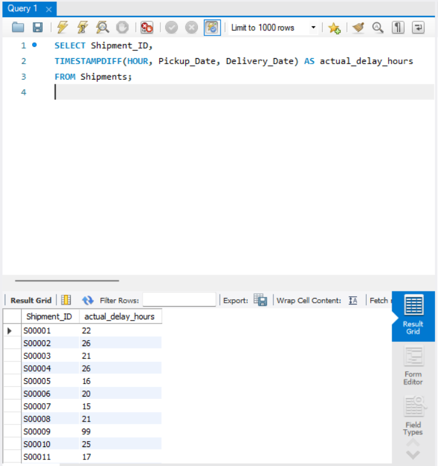
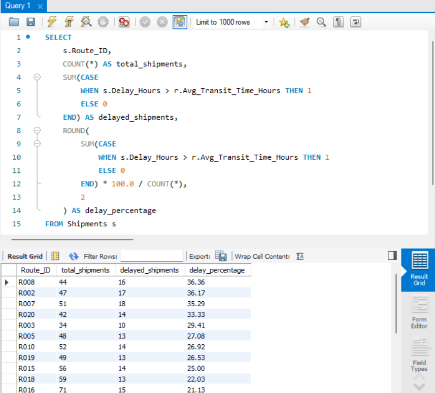
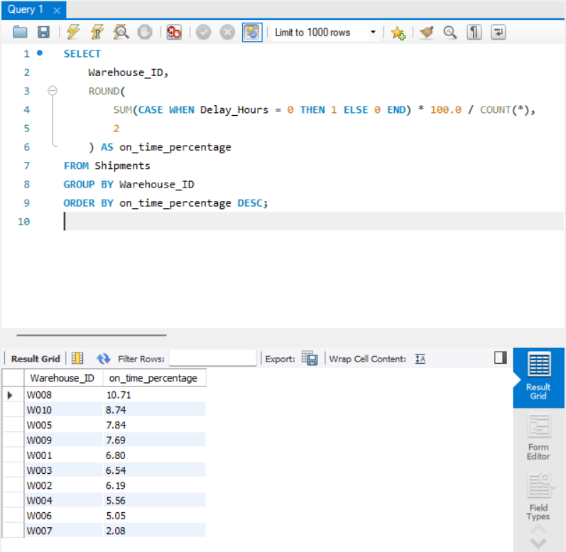
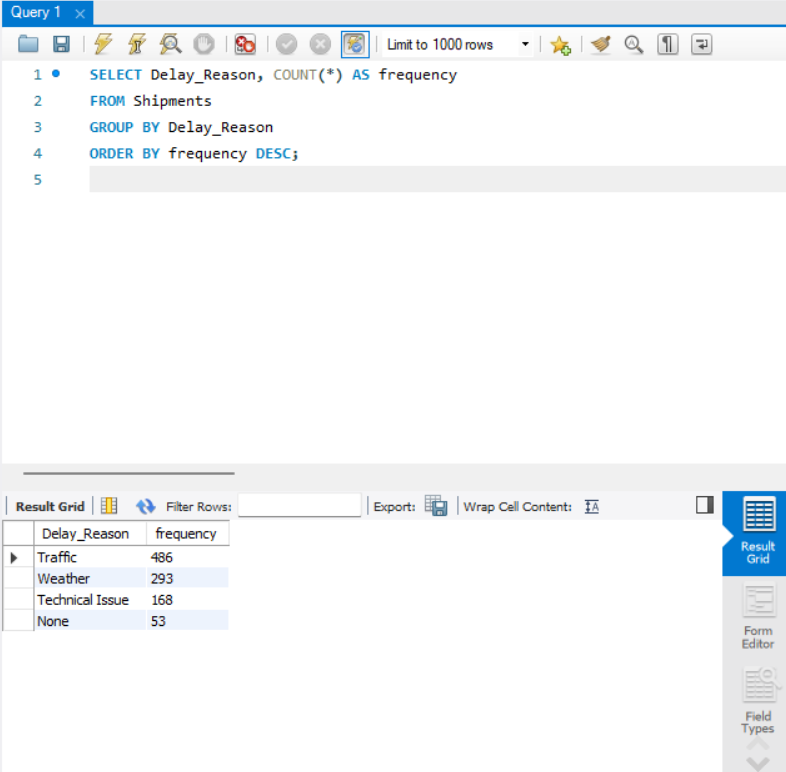
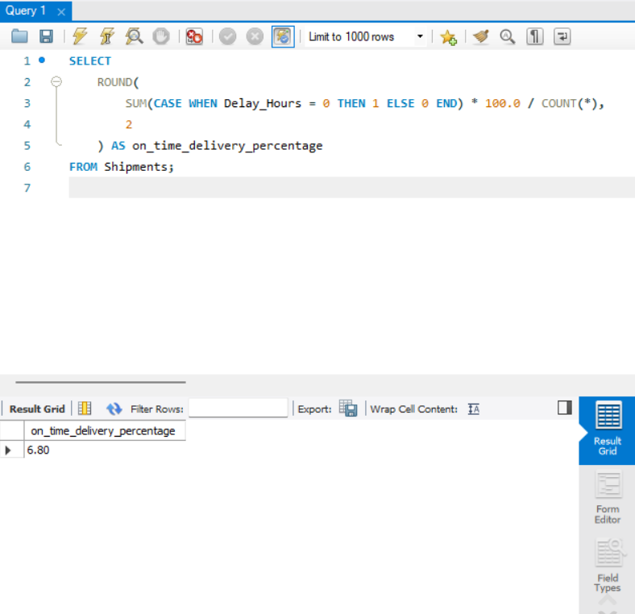
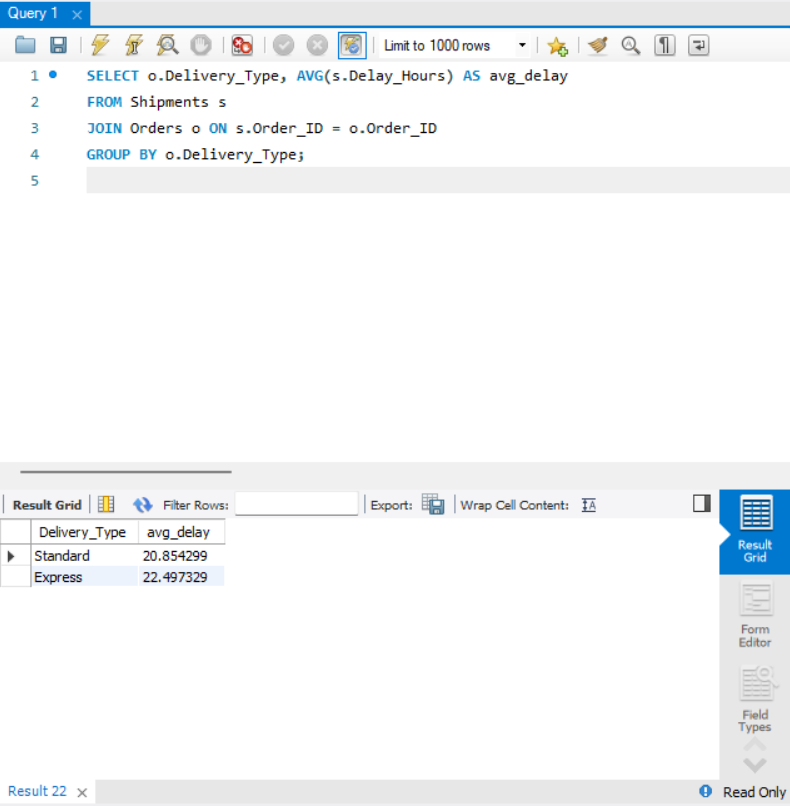

# 🚚 FedEx Logistics Optimization – SQL Analysis

SQL analysis of a 1,000-shipment logistics dataset (MySQL) to find where deliveries are delayed, which routes, warehouses and agents perform worst, and what is driving the delays.

**Tools:** MySQL Workbench · SQL (joins, CTEs, window functions, subqueries, CASE, aggregations)
**Walkthrough video:** [Watch here](https://drive.google.com/file/d/10Z978NwMgl_ima4WomjS4YaLEPV13tg8/view?usp=sharing)

## 🗂️ Dataset
Five related tables: **Orders, Shipments, Routes, Warehouses, Delivery_Agents**: 1,000 shipments across 20 routes and 10 warehouses.

## 🧮 What's in the Analysis
All queries are in [`fedex_analysis.sql`](fedex_analysis.sql), organised in 7 tasks:
1. **Data cleaning & validation:** NULL checks, date-order checks, referential integrity (0 NULL delays, 0 invalid dates, 0 orphan shipments).
2. **Delay analysis:** delay per shipment, top delayed routes, delay ranking per warehouse, delay by delivery type.
3. **Route optimisation:** efficiency ratio (km per transit hour), worst routes, routes with >20% delayed shipments.
4. **Warehouse performance:** top delayed warehouses, a CTE for warehouses above the global average, on-time ranking.
5. **Agent performance:** on-time ranking, low performers, top 5 vs bottom 5 by rating and experience.
6. **Shipment tracking:** status, in-transit/returned shipments by route, delay reasons, extreme delays (>120 h).
7. **KPI reporting:** average delay by source country and route, on-time delivery %.

## 📊 Key Findings
| Area | Finding |
|---|---|
| Overall | Average delay is **21.4 hours**. Only **6.8%** of shipments had zero delay. |
| Routes | **R002** has the highest average delay (**41.0 h**), then R007 (34.0 h) and R020 (32.8 h). |
| Delay reasons | **Traffic** causes the most delays (486 of 1,000), then Weather (293) and Technical Issues (168). |
| Warehouses | **W004 (25.9 h), W003 (25.5 h) and W008 (24.4 h)** are slowest. **W007** has the lowest on-time rate (2.1%). |
| Delivery type | **Express (22.5 h) was slightly slower than Standard (20.9 h)**, which is unexpected for a priority service. |
| Agents | The best agent's on-time rate is only 23.8%, so delays are a system-wide problem, not just a few agents. |

## 💡 Recommendations
1. Review routes R002, R007 and R020 first, since they have the longest delays.
2. Since traffic is the top reason (about half of delays), consider route timing and buffer times on high-traffic routes.
3. Investigate Express service performance, because it is not faster than Standard.
4. Look at warehouses W004, W003 and W008 for process bottlenecks.
5. Because delays are widespread across agents, focus on process fixes before individual coaching.

## 📁 Files
- `fedex_analysis.sql` – all queries
- `fedex_logistics(SQL).docx` – project report
- `images/` – query result screenshots

## 👩‍💻 Author
**Lakshita** · MCA (Data Analytics)
[GitHub](https://github.com/stakefire99) · [LinkedIn](https://www.linkedin.com/in/lakshita-047439224/)
